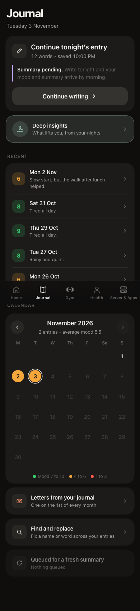
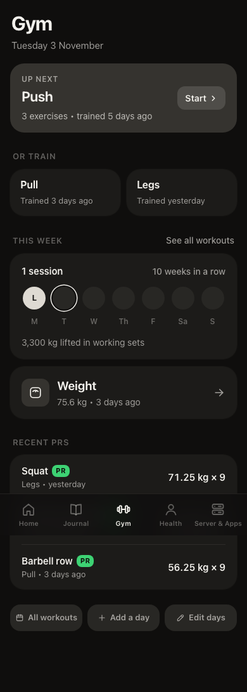
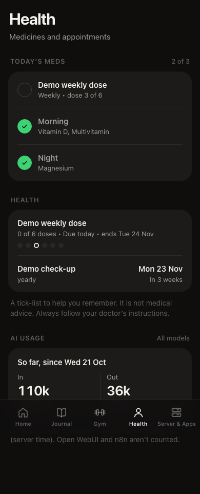

# Personal homelab server

A private assistant for your day that runs on your own machine: a dashboard, a Telegram bot, and optional apps for monitoring and local AI. Nothing leaves your computer unless you choose to connect it.

<p>
  
  
  
</p>

*Screenshots use fake demo data.*

## What it does

- **Dashboard** with notes, reminders and goals, a private journal with nightly and weekly summaries, a gym log, health reminders, a calendar view, weather, news, a world clock and a morning briefing.
- **Telegram bot** that understands plain words ("remind me to call the bank at 5") and answers from your own data.
- **Optional apps**, one choice at a time: Grafana and Prometheus monitoring, Ollama and Open WebUI for local AI, speech to text, n8n, Uptime Kuma, AdGuard and more.
- **Fits your machine.** A setup wizard looks at your hardware and suggests sensible AI models. Every optional feature shows a clear message and a fix when its dependency is missing, and never crashes.
- **Yours.** Your data lives in `~/.homelab`. Updates never touch it.

## Requirements

- macOS or Linux (Windows through WSL2 is planned)
- About 5 GB of free disk space, more if you want local AI models
- Python 3 and git. Docker is installed for you if it is missing (Colima on a Mac, Docker Engine on Linux).

## Install

```bash
curl -fsSL https://raw.githubusercontent.com/theappfoundryco/personal-homelab-server/main/get.sh | bash
```

It downloads the project to `~/personal-homelab-server`, asks a few questions up front (your name, optional extras), then does the long part quietly and opens the dashboard at http://localhost:3095. Run it again any time: it keeps your settings and passwords.

It starts on the newest tagged release (the `stable` channel), and `homelab update` moves you forward from there. To follow the newest work instead, add `HL_CHANNEL=edge` before `bash`, or run `homelab update --channel edge` later.

Prefer to look first? Clone it and run the installer yourself:

```bash
git clone https://github.com/theappfoundryco/personal-homelab-server.git
cd personal-homelab-server
./install.sh --help
./install.sh
```

## Update and uninstall

```bash
homelab update              # takes a snapshot first, and goes back by itself if anything fails
homelab uninstall           # stops and removes the containers, keeps your data
homelab uninstall --purge   # also deletes your data
```

## The `homelab` command

`homelab path add` puts it on your PATH. Then:

| Command | What it does |
|---|---|
| `homelab status` | what is running and how healthy it is |
| `homelab doctor` | the full health check, with a fix for each problem |
| `homelab modules` | list modules, or turn one on or off |
| `homelab apps` | list the optional apps, or add or remove them |
| `homelab backup`, `homelab restore` | save your data and settings to one file, bring it back |
| `homelab access` | who can open the dashboard: this machine only, or your home network with a PIN |
| `homelab logs`, `start`, `stop`, `restart` | the usual |

Run `homelab help` for the rest.

## Contribute

Fork it, make a branch, open a pull request into `main`. Your own data and settings stay in `~/.homelab` and are never part of a pull request. Start with [CONTRIBUTING.md](CONTRIBUTING.md). To build a new feature as a module, see [docs/modules.md](docs/modules.md).

- **Found a bug?** [Open an issue](https://github.com/theappfoundryco/personal-homelab-server/issues/new/choose) and remove personal information first.
- **Want a feature?** [Open a feature request](https://github.com/theappfoundryco/personal-homelab-server/issues/new/choose).
- **Have a question or an idea?** Ask in [Discussions](https://github.com/theappfoundryco/personal-homelab-server/discussions).
- **Found a security problem?** Report it privately, see [SECURITY.md](SECURITY.md).

## Important notice

This is a personal-organisation tool, not a medical device, and it gives no medical, psychological, legal or financial advice. Read [docs/DISCLAIMER.md](docs/DISCLAIMER.md).

## License

[MIT](LICENSE), made by [The App Foundry](https://theappfoundry.co).
