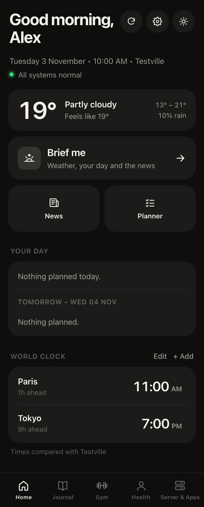
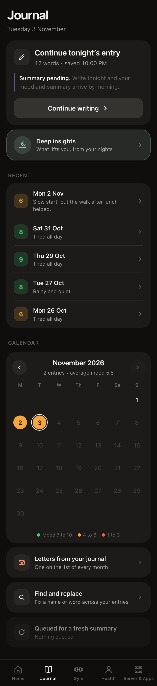
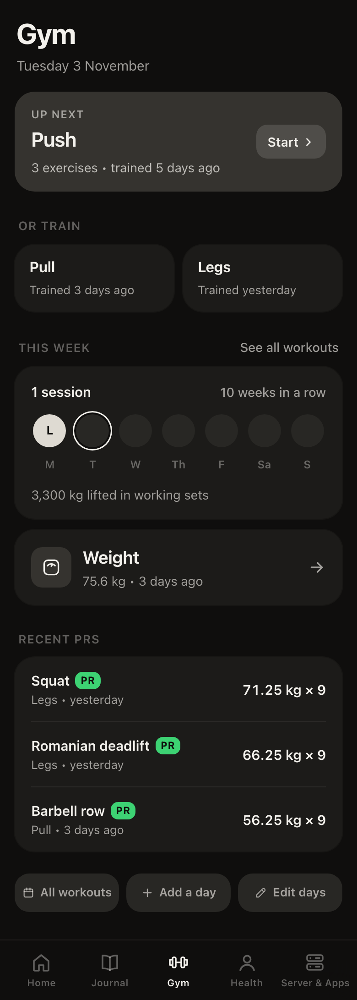
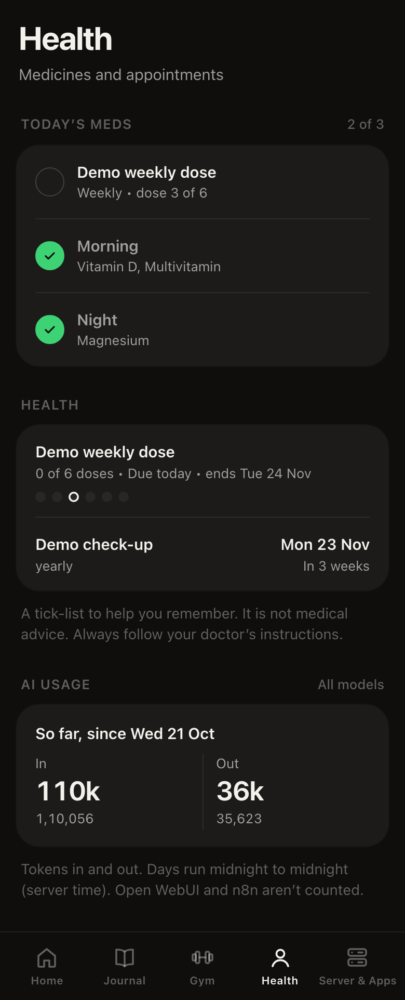

# Personal homelab server

A private assistant for your day that runs on your own machine: a dashboard, a Telegram bot, and optional apps for monitoring and local AI. Nothing leaves your computer unless you choose to connect it.

<table>
  <tr>
    <td align="center"><br><sub><b>Home</b><br>weather, your day, a morning briefing</sub></td>
    <td align="center"><br><sub><b>Journal</b><br>write your night, see the mood over time</sub></td>
    <td align="center"><br><sub><b>Gym</b><br>workouts, streaks and personal records</sub></td>
    <td align="center"><br><sub><b>Health</b><br>medicine and appointment reminders</sub></td>
  </tr>
</table>

*All screenshots come from fake demo data (`demo/generate.py`) and are recorded by `demo/screenshots.py`.*

## What it does

**A dashboard that works like an app on your phone.** Open it in any browser on your home network and add it to your home screen. Dark and light themes, and every size and colour comes from one set of design tokens.

- **Home.** A greeting, the weather, what is on today and tomorrow, a world clock, and a **Brief me** button that reads out a short morning briefing (weather, your calendar, the news and a server recap). Each part drops out quietly when its source is missing.
- **Journal.** Write your day. Optionally get a private nightly summary, a mood score, a weekly recap and deeper insights, all written by a model that runs on your own machine.
- **Gym.** Log workouts (training days, exercises, sets, body weight), see your weekly streak, personal records and progress charts.
- **Health.** Medicine times, weekly courses and appointments that you add yourself. A tick-list for remembering, never medical advice.
- **Planner and notes.** Say it in plain words: notes, one-off or repeating reminders, and long-term goals.
- **News, weather, flights, email.** Headlines by topic with short AI digests, forecasts for home or any city, flights found in your calendar with a "time to leave" nudge, and a short list of important email (Gmail app password, off until you add one).
- **Server and apps.** See whether anything is down, how hot the machine is, restart an app or read its logs, and add your own Docker apps.

**A Telegram bot.** Talk to it in plain words ("remind me to water the plants tomorrow", "any important emails") and it answers from your own data.

**Optional apps, one choice at a time.** Grafana and Prometheus for monitoring, Ollama and Open WebUI for local AI, speech to text, n8n, Uptime Kuma, AdGuard and more. Nothing is installed that you did not pick.

**It fits your machine and never breaks quietly.** A setup wizard looks at your hardware and suggests sensible AI models. Every optional feature (AI, internet, calendar, Telegram) shows a clear message and a fix when its dependency is missing. Run `homelab doctor` for the full picture.

**It is yours.** Your data lives in `~/.homelab`, outside the project folder. Updates never touch it, and backups are one command.

## Requirements

- macOS or Linux (Windows through WSL2 is planned)
- About 5 GB of free disk space, more if you want local AI models
- Python 3 and git. Docker is installed for you if it is missing (Colima on a Mac, Docker Engine on Linux).

## Install

```bash
curl -fsSL https://raw.githubusercontent.com/theappfoundryco/personal-homelab-server/main/get.sh | bash
```

It downloads the project to `~/personal-homelab-server`, asks a few questions up front (your name, optional extras), then does the long part quietly and opens the dashboard at http://localhost:3095. Run it again any time: it keeps your settings and passwords.

It starts on the newest tagged release (the `stable` channel), and `homelab update` moves you forward from there. To follow the newest work instead, add `HL_CHANNEL=edge` before `bash`, or run `homelab update --channel edge` later.

Prefer to look first? Clone it and run the installer yourself:

```bash
git clone https://github.com/theappfoundryco/personal-homelab-server.git
cd personal-homelab-server
./install.sh --help
./install.sh
```

## Update and uninstall

```bash
homelab update              # takes a snapshot first, and goes back by itself if anything fails
homelab uninstall           # stops and removes the containers, keeps your data
homelab uninstall --purge   # also deletes your data
```

## The `homelab` command

`homelab path add` puts it on your PATH. Then:

| Command | What it does |
|---|---|
| `homelab status` | what is running and how healthy it is |
| `homelab doctor` | the full health check, with a fix for each problem |
| `homelab modules` | list modules, or turn one on or off |
| `homelab apps` | list the optional apps, or add or remove them |
| `homelab backup`, `homelab restore` | save your data and settings to one file, bring it back |
| `homelab access` | who can open the dashboard: this machine only, or your home network with a PIN |
| `homelab logs`, `start`, `stop`, `restart` | the usual |

Run `homelab help` for the rest.

## Contribute

Fork it, make a branch, open a pull request into `main`. Your own data and settings stay in `~/.homelab` and are never part of a pull request. Start with [CONTRIBUTING.md](CONTRIBUTING.md). To build a new feature as a module, see [docs/modules.md](docs/modules.md).

- **Found a bug?** [Open an issue](https://github.com/theappfoundryco/personal-homelab-server/issues/new/choose) and remove personal information first.
- **Want a feature?** [Open a feature request](https://github.com/theappfoundryco/personal-homelab-server/issues/new/choose).
- **Have a question or an idea?** Ask in [Discussions](https://github.com/theappfoundryco/personal-homelab-server/discussions).
- **Found a security problem?** Report it privately, see [SECURITY.md](SECURITY.md).

## Important notice

This is a personal-organisation tool, not a medical device, and it gives no medical, psychological, legal or financial advice. Read [docs/DISCLAIMER.md](docs/DISCLAIMER.md).

## License

[MIT](LICENSE), made by [The App Foundry](https://theappfoundry.co).
